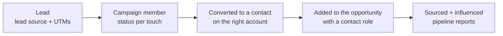

# B2B Pipeline Attribution Playbook

A practical guide to measuring marketing's contribution to pipeline in a B2B CRM, mainly Salesforce, with notes for HubSpot.

Most B2B teams have the tools to show which campaigns created and moved pipeline. What breaks is the chain of records in between: a lead that never gets converted, a contact with no role on the deal, a UTM that never reaches the CRM. This playbook walks through that chain step by step. It also includes sample data, SQL and templates so you can test it yourself.

## The chain

If any link is missing, the campaign's credit stops there.

## What's inside

| # | Part | The question it answers |
|---|---|---|
| 1 | [Define the funnel](docs/01-define-the-funnel.md) | What counts as a lead, MQL, SAL, SQL and opportunity here? |
| 2 | [Capture the source](docs/02-capture-the-source.md) | Where did this person come from, and what did they engage with? |
| 3 | [Convert the lead and match the account](docs/03-convert-and-match.md) | Is this person tied to the right company record? |
| 4 | [Attach contacts with contact roles](docs/04-contact-roles.md) | Which buyers are on this deal? |
| 5 | [Sourced vs. influenced pipeline](docs/05-sourced-vs-influenced.md) | Did marketing start the deal, help it along, or both? |
| 6 | [Attribution models and tools](docs/06-attribution-models-and-tools.md) | How should credit be split across campaigns? |
| 7 | [Reconcile and audit the data](docs/07-reconcile-and-audit.md) | Why don't the numbers match across systems? |
| 8 | [Close the loop with ad platforms](docs/08-close-the-loop.md) | How do ad platforms learn which clicks became real pipeline? |

**Try it yourself**
- [`data/`](data/): a small, **fully made-up** dataset (accounts, leads, contacts, campaigns, campaign members, opportunities and contact roles), with common data problems built in on purpose. No real companies, people or results. See [data/README.md](data/README.md).
- [`sql/`](sql/): queries for sourced vs. influenced pipeline, three attribution models, and a data audit. See [sql/README.md](sql/README.md) to run them in SQLite in two minutes.
- [`templates/`](templates/): funnel definitions, a lead scoring sheet, a monthly audit checklist, a discrepancy log and spreadsheet formulas.

## Lessons from the field

These come from more than ten years of B2B demand generation at marketing and advertising technology companies. Company names and numbers are left out.

**1. The report wasn't broken. The contact roles were missing.**
A team wanted multi-touch attribution, but the Campaign Influence report came back almost empty. Sales rarely added contact roles to opportunities, so campaign activity never linked to deals. Sales Ops backfilled roles for past deals with an automation, and the influence report worked from then on. The longer-term fix was a rule that a deal can't move to a later stage without contact roles.

**2. An influence report can make one email look like it touched every deal.**
Email campaigns often add everyone on the send list as a campaign member with a status like "Sent" or "Received." If those statuses count, the influence report credits the email on every deal those people are part of, whether or not anyone opened it. Before presenting influenced pipeline, filter to people who actually clicked, attended or downloaded, so the number holds up when sales asks about it. See [Part 7](docs/07-reconcile-and-audit.md).

## Related

- [B2B Paid Media Planner](https://github.com/rachelhong-marketing/b2b-paid-media-planner): planning the paid media side, including channel roles by funnel stage, budget split, UTM naming and Salesforce campaign structure. Use it to set campaigns up; use this playbook to measure what they did for pipeline.

## Who this is for

Demand generation, marketing operations and revenue operations people who need to answer "what did marketing contribute to pipeline?" with data the sales team will trust.

## A note on accuracy

Salesforce and HubSpot change their features and names often. For example, Pardot is now called Marketing Cloud Account Engagement, and HubSpot has replaced some of its attribution models. Check your own org's settings and the vendors' current help docs before you build anything. Links to the docs used are at the end of each part.

## About the author

**Rachel Hong** has worked in B2B demand generation and marketing analytics for more than ten years, at marketing and advertising technology companies. She builds campaigns, reporting and the CRM processes that connect marketing to pipeline.

[LinkedIn](https://www.linkedin.com/in/rachelhongatbaruch/)
